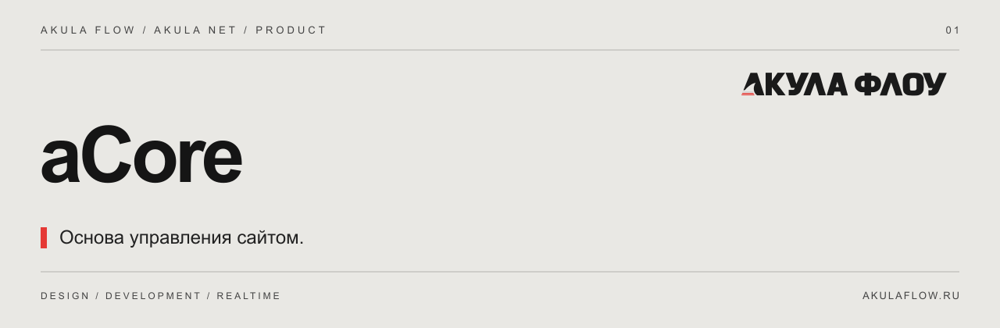

[Сайт](https://akulaflow.ru/) · [GitHub](https://github.com/yanakulov/acore) · [GitVerse](https://gitverse.ru/yanakulov/acore) · [Changelog](CHANGELOG.md)

# aCore · Сердце Акулы

**Страницы, пользователи, медиа и SEO — в одном интерфейсе.**

Часть экосистемы [Akula Net](https://github.com/yanakulov/anet) от [Акулы Флоу](https://akulaflow.ru/). Работает с общей авторизацией и пользователями aNet.

## Возможности

- Каталог страниц и управление контентом.
- Пользователи, роли и обязательная смена временного пароля.
- Медиатека с WebP/AVIF, SEO и Open Graph.
- Подключение клиентских установок и каталог модулей.
- Общий обзор просмотров и кликов.

## Подключение

Базовая часть aNet. Отдельная лицензия модуля не требуется.

aCore обеспечивает основу для остальных модулей.

## Версия

Описание соответствует текущей aNet **1.0.0**. Отдельная версия aCore не заявляется. Совместимые пакеты AF — **0.2.0**.

## Другие части экосистемы

[aVision](https://github.com/yanakulov/avision) · [aFlow](https://github.com/yanakulov/aflow) · [aJaws](https://github.com/yanakulov/ajaws) · [aSense](https://github.com/yanakulov/asense)

## О репозитории

Это публичный информационный репозиторий: описание продукта и журнал изменений. Исходники развиваются в приватных репозиториях. Публикация описания не предоставляет лицензию на программное обеспечение.

Сайт и связь со студией: [akulaflow.ru](https://akulaflow.ru/).
